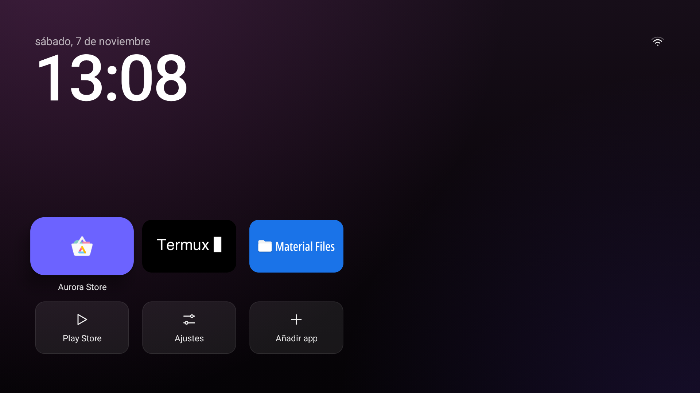
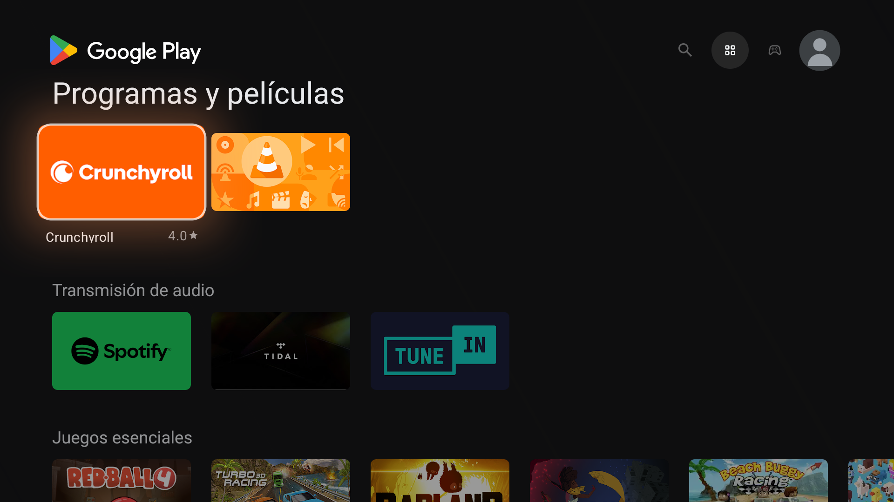
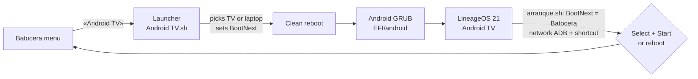

# Batocera Android TV · RS Groove

[Español](README.md) · **English**

Android TV on the same PC as your Batocera, **with its own entry in the Batocera menu**. Pick it with the gamepad,
the PC reboots into native Android TV (no virtual machine, full hardware power), and when you are done press
**Select + Start** to go back to Batocera.

Made by **Richard Campos (RS Groove)**.

## Features

- **«Android TV» entry in the Batocera menu.** Reboots into Android with a one-time UEFI boot (`BootNext`): Batocera
  always stays first in the boot order.
- **Automatic screen.** TV connected over HDMI → Android shows on the TV; otherwise on the laptop screen. Manual
  entries too.
- **Back to Batocera with Select + Start** (together), or by rebooting Android.
- **Batocera-style buttons:** Cross (X) accepts, Circle goes back, Select goes to the Android home.
- **Volume on the right stick**, like Batocera: up raises it, down lowers it (hold to repeat).
- **Laptop keyboard in Spanish** (Latin America or Spain) with a one-command script.
- **Batocera is not touched.** Everything lives in `/userdata/android-tv`, one menu folder and its own UEFI entry, so
  Batocera updates do not remove it.
- **Time zone and language** set from boot (Argentina on the test machine; one line to change).
- **PC control over ADB** (screenshots, keys, installing apps), key-authorized.
- **Light Google Play:** microG + the Android TV Play Store for x86_64, without the ARM translator
  ([docs/GOOGLE.md](docs/GOOGLE.md), in Spanish).

## How it works

## Tested on

| Item | Detail |
| --- | --- |
| Machine | Dell Inspiron 3493 (Intel Core i5-1035G1, Intel UHD G1, 16 GB, UEFI, Secure Boot off) |
| Batocera | 43.1, x86_64 |
| Android | LineageOS 21 Android TV x86_64 `20260331` (LineageOS-TV-x86 community) |
| Output | HDMI to a 1080p 60 Hz TV, or the laptop screen |
| Gamepad | ShanWan PS3/PC (USB `2563:0523`) |
| Wi-Fi | Qualcomm QCA9377 (2.4 and 5 GHz with WPA2) |

Screen names (`eDP-1`, `HDMI-A-1`) and the button layout file belong to this machine: see «Adaptar a otro equipo» in
[docs/INSTALAR.md](docs/INSTALAR.md).

## Install

Step-by-step guide with the exact commands used (Spanish): **[docs/INSTALAR.md](docs/INSTALAR.md)**.

1. Download the official LineageOS-TV-x86 ISO and check its sha256.
2. Copy `kernel`, `initrd.img`, `system.efs` and `ramdisk-recovery.img` to `/userdata/android-tv/`.
3. Put the Android loader (GRUB) on a FAT32 partition that is **not** the Batocera one, with this repo's `grub.cfg`,
   and create the «Android TV» UEFI entry **outside the boot order** (`efibootmgr -C`).
4. Copy the menu entry (`batocera/`) to `/userdata`.
5. First boot, make the system writable (`system.img`), add `arranque.sh`, the custom `init.sh` and the button file.
6. Google Play: [docs/GOOGLE.md](docs/GOOGLE.md).

## Daily use

| I want to… | How |
| --- | --- |
| Start Android TV | Batocera menu → **Android TV** → **Android TV** |
| Go back to Batocera | **Select + Start** together, or *Restart* from Android |
| Accept / go back | **Cross (X)** accepts · **Circle** goes back |
| Android home | **Select** |
| Volume up / down | **Right stick** up or down (hold to keep going) |
| Pick the screen manually | Android boot menu: «solo la tele» (TV only) or «solo la pantalla de la notebook» (laptop only) |

## Not included

The Android ISO, `system.img`, the Play Store, microG and any other third-party files: only official links and their
sha256. No keys, ADB keys or account data either.

Use official, licensed apps. This project does not install or support apps that stream movies or channels without
rights.

## Versions, credits, license

- Every improvement or fix ships as a new version: [CHANGELOG.md](CHANGELOG.md).
- Scripts, configuration, docs and photos in this repo: **[Creative Commons BY-NC-SA 4.0](LICENSE.md)**, © 2026
  Richard Campos (RS Groove), the same license as the RS Groove Batocera theme. You may share, copy and **modify** it,
  crediting Richard Campos (RS Groove) with a link to this repository, indicating changes and keeping the same
  license. No commercial use.
- Android, microG, the Play Store and the other parts belong to their authors: [CREDITOS.md](CREDITOS.md).
