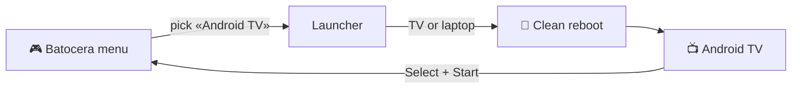

# 📺 Android TV RS Groove

### Android TV on your Batocera, with its own entry in the menu

Pick **Android TV** with the gamepad, the PC boots native Android at full power, 
and when you are done press **Select + Start** to get back to your games.

[Español](README.md) · **English**

The RS Groove home: anime wallpapers that change every minute, clock, greeting and your apps at hand.

---

## ✨ Features

| | |
| :---: | --- |
| 🎮 | **Batocera menu entry.** One more «Android TV» system next to your consoles. |
| 📺 | **Automatic screen.** TV plugged in → HDMI; no TV → the laptop screen. |
| ↩️ | **Back with Select + Start.** Any reboot also lands back in Batocera. |
| 🕹️ | **Batocera-style gamepad.** Cross accepts, Circle goes back, Select goes home and the **right stick changes the volume**. |
| 🖼️ | **RS Groove home.** Apple TV style, with **anime wallpapers that change every minute** and refresh every day, plus an offline reserve. |
| 📱 | **Your phone as the remote.** With the Google TV app: D-pad, volume and keyboard. |
| 🛒 | **Light Google Play.** microG + the TV Play Store for this CPU, no translator. Chrome and Google Drive too. |
| ⌨️ | **Spanish keyboard.** ñ, accents and @ work on the laptop keyboard. |
| 🛡️ | **Batocera untouched.** Everything lives apart, so Batocera updates do not remove it. |

## 📸 Screenshots

<table>
  <tr>
    <td width="50%"></td>
    <td width="50%"></td>
  </tr>
  <tr>
    <td align="center"><b>RS Groove home</b> · Chrome and Drive banners, wallpapers that change by themselves</td>
    <td align="center"><b>Google Play</b> · TV version, fast, with every cover</td>
  </tr>
</table>

## ⚙️ How it works

Every piece explained (Spanish): **[docs/COMO-FUNCIONA.md](docs/COMO-FUNCIONA.md)**.

## 🚀 Install

> [!TIP]
> The full guide, with every command exactly as used, is in **[docs/INSTALAR.md](docs/INSTALAR.md)** (Spanish).

1. 💿 **Download Android TV** (LineageOS 21 for PC) and check its hash.
2. 📂 **Copy** its files to Batocera's `/userdata/android-tv/`.
3. 🧭 **Put its loader** on a separate partition and create the «Android TV» boot entry.
4. 🎮 **Add the entry** to the Batocera menu.
5. 🛠️ **First boot** and the finishing touches: Select + Start, buttons, keyboard.
6. 🛒 **Google Play, Chrome and Drive** → [docs/GOOGLE.md](docs/GOOGLE.md)
7. 🖼️ **RS Groove home** → [docs/INICIO.md](docs/INICIO.md) · **Daily wallpapers** → [docs/FONDOS.md](docs/FONDOS.md)
8. 📱 **Phone as the remote** → [docs/CELULAR.md](docs/CELULAR.md)

## 🕹️ Daily use

| I want to… | How |
| --- | --- |
| Start Android TV | Batocera menu → **Android TV** |
| Go back to Batocera | **Select + Start** together |
| Accept · go back | **Cross** · **Circle** |
| Go home | **Select** |
| Volume up or down | **Right stick** up or down |
| Use the phone | **Google TV** app → Remote → **Android TV RS Groove** |
| Add or remove home apps | **App library**, after the last row |

## 🧪 Tested on

| | |
| --- | --- |
| 💻 Machine | Dell Inspiron 3493 · Intel Core i5-1035G1 · 16 GB |
| 🎮 Batocera | 43.1 |
| 📺 Android | LineageOS 21 Android TV x86_64 `20260331` |
| 🖥️ Output | 1080p TV over HDMI, or the laptop screen |
| 🕹️ Gamepad | ShanWan PS3/PC |

## 🔒 What it does not ship (on purpose)

- **No keys.** Keys (for example Unsplash's, for the wallpapers) belong to each user and stay on their device.
- **Nothing from others.** No Android, Play Store, microG, Chrome, Drive or Wallhaven art: only official links and hashes.
- **No personal data.** No accounts, networks or keys.

Use official, licensed apps. This project does not install or support apps that stream movies or channels without rights.

## 📜 License and credits

[**Creative Commons BY-NC-SA 4.0**](LICENSE.md) — the same as the [RS Groove Batocera theme](https://github.com/RichardS-Groove/es-theme-artflix-cobalto-alekfull-rs-groove):
share, copy and **modify** it, credit **Richard Campos (RS Groove)** with a link, say what you changed and keep the same
license. No commercial use.

Android, microG, the Play Store, CleanYourTV and the images belong to their authors: **[CREDITOS.md](CREDITOS.md)**.
Every version in detail: **[CHANGELOG.md](CHANGELOG.md)**.

---

Made with 💜 by **Richard Campos · RS Groove**

