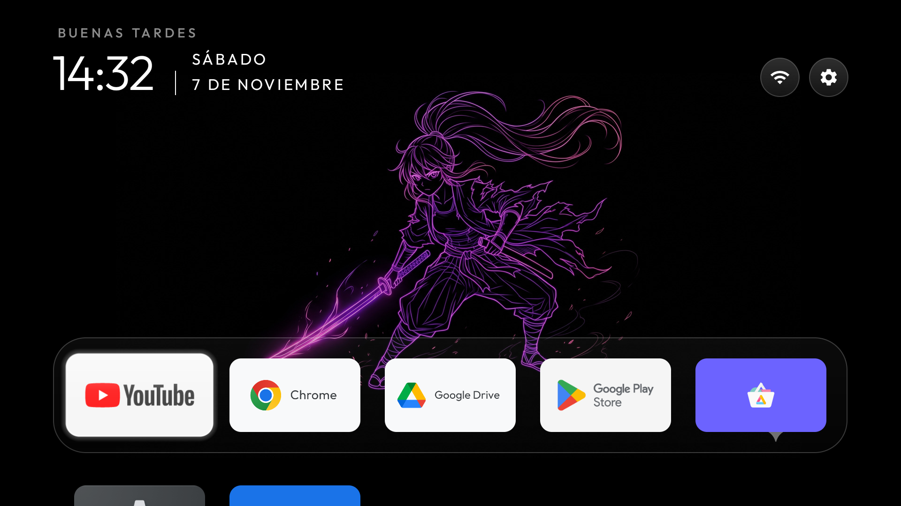
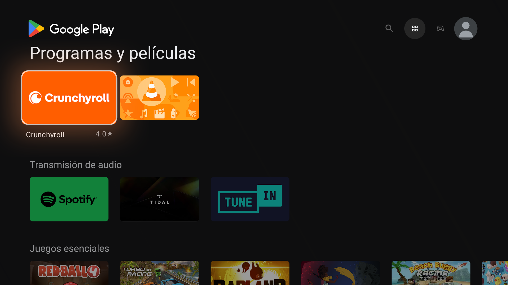
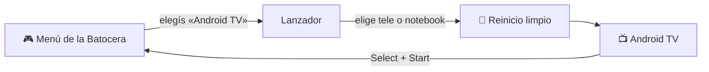

# 📺 Android TV RS Groove

### Android TV en tu Batocera, con su propia entrada en el menú

Elegís **Android TV** con el joystick, la PC arranca Android nativo con toda su potencia, 
y cuando terminás apretás **Select + Start** y volvés a tus juegos.

**Español** · [English](README.en.md)

El inicio RS Groove: fondos de anime que cambian cada minuto, reloj, saludo y tus apps a mano.

---

## ✨ Qué tiene

| | |
| :---: | --- |
| 🎮 | **Entrada en el menú de la Batocera.** Un sistema «Android TV» más, al lado de tus consolas. |
| 📺 | **Pantalla automática.** Con la tele conectada pasa sola a la tele, con el sonido por HDMI, aunque la enchufes después; sin tele, la pantalla de la notebook. |
| 🌙 | **Apagá la tele para dormir.** Con la «tele fija», apagarla y prenderla con su control no traba Android ni reinicia el menú de la Batocera. Y Android no se duerme nunca. |
| ❌ | **Cerrar todo.** Una app del inicio (o **Select + Círculo**) cierra todas las apps abiertas, también un video flotante. |
| ↩️ | **Volver con Select + Start.** Cualquier reinicio también vuelve solo a la Batocera. |
| 🕹️ | **El joystick como en la Batocera.** Cruz acepta, Círculo vuelve, Select va al inicio y la **palanca derecha sube y baja el volumen**. |
| 🖼️ | **Inicio RS Groove.** Estilo Apple TV, con **fondos de anime que cambian cada minuto** y se renuevan cada día. Guarda una reserva para cuando no hay internet. |
| 🌤️ | **El clima en el inicio.** Arriba a la derecha, con Open-Meteo, sin clave. |
| 📱 | **Tu celular como control.** Con la app Google TV: flechas, volumen y teclado. |
| 🛒 | **Google Play liviano.** microG + la Play Store de TV para este procesador, sin traductor. Además Chrome y Google Drive. |
| ⌨️ | **Teclado en español.** La ñ, los acentos y la @ funcionan en el teclado de la notebook. |
| 🛡️ | **No toca la Batocera.** Todo vive aparte: las actualizaciones de la Batocera no lo borran. La tele fija suma, si querés, un gancho de arranque (`/boot/postshare.sh`). |

## 📸 Así se ve

<table>
  <tr>
    <td width="50%"></td>
    <td width="50%"></td>
  </tr>
  <tr>
    <td align="center"><b>Inicio RS Groove</b> · carteles para Chrome y Drive, fondos que cambian solos</td>
    <td align="center"><b>Google Play</b> · versión de TV, rápida y con todas las carátulas</td>
  </tr>
</table>

## ⚙️ Cómo funciona

Cada pieza, explicada: **[docs/COMO-FUNCIONA.md](docs/COMO-FUNCIONA.md)**.

## 🚀 Instalar

> [!TIP]
> La guía completa, con cada comando tal cual se usó, está en **[docs/INSTALAR.md](docs/INSTALAR.md)**.

1. 💿 **Bajar Android TV** (LineageOS 21 para PC) y comprobar su huella.
2. 📂 **Copiar** sus archivos a la carpeta `/userdata/android-tv/` de la Batocera.
3. 🧭 **Poner su cargador** en una partición aparte y crear la entrada «Android TV» del equipo.
4. 🎮 **Sumar la entrada** al menú de la Batocera.
5. 🛠️ **Primer arranque** y los toques finales: volver con Select + Start, botones, teclado.
6. 🛒 **Google Play, Chrome y Drive** → [docs/GOOGLE.md](docs/GOOGLE.md)
7. 🖼️ **El inicio RS Groove** → [docs/INICIO.md](docs/INICIO.md) · **Fondos nuevos cada día** → [docs/FONDOS.md](docs/FONDOS.md)
8. 📱 **El celular como control** → [docs/CELULAR.md](docs/CELULAR.md)

## 🕹️ Uso diario

| Quiero… | Cómo |
| --- | --- |
| Entrar a Android TV | Menú de la Batocera → **Android TV** |
| Volver a la Batocera | **Select + Start** juntos |
| Aceptar · volver | **Cruz** · **Círculo** |
| Ir al inicio | **Select** |
| Subir o bajar el volumen | **Palanca derecha** arriba o abajo |
| Manejarlo desde el celular | App **Google TV** → Control remoto → **Android TV RS Groove** |
| Cerrar todas las apps (también un video flotante) | App **Cerrar todo** o **Select + Círculo** |
| Sumar o sacar apps del inicio | **Biblioteca de aplicaciones**, al final de las filas |
| Apagar la tele para dormir | Con el **control de la tele**: Android y la Batocera siguen igual al prenderla |

## 📚 Guías

| Guía | De qué trata |
| --- | --- |
| [Instalar](docs/INSTALAR.md) | Todo el armado, paso a paso |
| [Cómo funciona](docs/COMO-FUNCIONA.md) | El recorrido completo y cada archivo |
| [Google](docs/GOOGLE.md) | microG, Play Store para TV, Chrome y Drive |
| [Inicio RS Groove](docs/INICIO.md) | El inicio CleanYourTV, el tema y los carteles |
| [Fondos](docs/FONDOS.md) | Fondos de anime y fotos nuevas cada día, con reserva sin internet |
| [Celular](docs/CELULAR.md) | El celular como control remoto |
| [Control desde la PC](docs/CONTROL-ADB.md) | Fotos de pantalla, teclas e instalar apps por ADB |
| [Problemas](docs/PROBLEMAS.md) | Lo que pasó en las pruebas y cómo se arregló |

## 🧪 Probado en

| | |
| --- | --- |
| 💻 Equipo | Dell Inspiron 3493 · Intel Core i5-1035G1 · 16 GB |
| 🎮 Batocera | 43.1 |
| 📺 Android | LineageOS 21 Android TV x86_64 `20260331` |
| 🖥️ Salida | Tele 1080p por HDMI, o la pantalla de la notebook |
| 🕹️ Joystick | ShanWan PS3/PC |

Otros equipos pueden andar igual; lo que cambia de un equipo a otro está en [docs/INSTALAR.md](docs/INSTALAR.md),
«Adaptar a otro equipo».

## 🔒 Lo que no trae (a propósito)

- **Ninguna clave.** Las claves (por ejemplo la de Unsplash para los fondos) son de cada uno y se guardan solo en el equipo.
- **Nada de otros.** Ni Android, ni la Play Store, ni microG, ni Chrome o Drive, ni el arte de Wallhaven: solo los enlaces
  oficiales y sus huellas.
- **Ningún dato personal.** Ni cuentas, ni redes, ni llaves.

Usá apps oficiales, con licencia. Este proyecto no instala ni da soporte a apps que pasan películas o canales sin derechos.

## 📜 Licencia y créditos

[**Creative Commons BY-NC-SA 4.0**](LICENSE.md) — la misma del [tema RS Groove para Batocera](https://github.com/RichardS-Groove/es-theme-artflix-cobalto-alekfull-rs-groove):

- ✅ Se puede compartir, copiar y **modificar**.
- 📝 Nombrando a **Richard Campos (RS Groove)** con un enlace a este proyecto, contando qué cambiaste y con la misma licencia.
- 🚫 Sin uso comercial: no se vende ni se cobra.

Android, microG, la Play Store, CleanYourTV y las imágenes son de sus autores: **[CREDITOS.md](CREDITOS.md)**.
Cada versión, con su detalle: **[CHANGELOG.md](CHANGELOG.md)**.

---

Hecho con 💜 por **Richard Campos · RS Groove**

