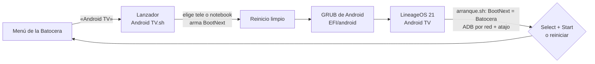

# Android TV RS Groove


[](LICENSE.md)


**Español** · [English](README.en.md)

Android TV en la misma PC que tu **Batocera**, **con su propia entrada en el menú**. La elegís con el joystick, la PC
reinicia en Android TV nativo (sin máquina virtual, con toda la potencia del equipo) y, cuando terminás, apretás
**Select + Start** y volvés a la Batocera.

Hecho por **Richard Campos (RS Groove)**.


## Qué hace

- **Entrada «Android TV» en el menú de la Batocera.** Reinicia la PC en Android con un arranque de una sola vez
  (`BootNext` de UEFI): la Batocera sigue siendo lo primero que arranca siempre.
- **Pantalla automática.** Si la tele está conectada por HDMI, Android sale por la tele; si no, por la pantalla de la
  notebook. También hay entradas para elegirla a mano.
- **Vuelta a la Batocera con Select + Start** (juntos), o reiniciando Android.
- **Botones como en la Batocera:** Cruz (X) acepta, Círculo vuelve, Select va al inicio de Android.
- **Volumen con la palanca derecha**, como en la Batocera: arriba sube, abajo baja (sostenida, repite).
- **Teclado de la notebook en español** (Latinoamérica o España), con una receta de un solo comando.
- **Inicio «RS Groove»:** el inicio estilo Apple TV de CleanYourTV con un tema propio de **18 imágenes que cambian
  cada minuto** (anime, paisajes y la Tierra desde el espacio). Ver [docs/INICIO.md](docs/INICIO.md).
- **El celular como control remoto** con la app Google TV (con el arreglo que necesitó). Ver
  [docs/CELULAR.md](docs/CELULAR.md).
- **Chrome y Google Drive** (versiones de celular, que Google no publica para TV). Ver [docs/GOOGLE.md](docs/GOOGLE.md).
- **No toca la Batocera.** Todo vive en `/userdata/android-tv`, en una carpeta del menú y en una entrada UEFI propia.
  Las actualizaciones de la Batocera no lo borran.
- **Hora e idioma** fijados desde el arranque (en este equipo, Argentina; se cambia en una línea).
- **Control desde la PC por ADB** (fotos de pantalla, teclas, instalar apps), con autorización de llave.
- **Google Play liviano:** microG + la Play Store de Android TV para x86_64, sin traductor ARM (ver
  [docs/GOOGLE.md](docs/GOOGLE.md)).


## Cómo funciona



Detalle de cada pieza en [docs/COMO-FUNCIONA.md](docs/COMO-FUNCIONA.md).

## Probado en

| Qué | Detalle |
| --- | --- |
| Equipo | Dell Inspiron 3493 (Intel Core i5-1035G1, Intel UHD G1, 16 GB, UEFI, arranque seguro apagado) |
| Batocera | 43.1, x86_64 |
| Android | LineageOS 21 Android TV x86_64 `20260331` (comunidad LineageOS-TV-x86) |
| Salida | HDMI a una tele 1080p 60 Hz, o la pantalla de la notebook |
| Joystick | ShanWan PS3/PC (USB `2563:0523`) |
| Wi-Fi | Qualcomm QCA9377 (2,4 y 5 GHz con WPA2) |

Otros equipos pueden andar igual, pero los nombres de pantalla (`eDP-1`, `HDMI-A-1`) y el archivo de botones son de
este equipo: ver [docs/INSTALAR.md](docs/INSTALAR.md), «Adaptar a otro equipo».

## Instalar

Guía paso a paso, con los comandos tal cual se usaron: **[docs/INSTALAR.md](docs/INSTALAR.md)**.

En corto:

1. Bajar la ISO oficial de LineageOS-TV-x86 y comprobar su huella sha256.
2. Copiar `kernel`, `initrd.img`, `system.efs` y `ramdisk-recovery.img` a `/userdata/android-tv/`.
3. Poner el cargador de Android (GRUB) en una partición FAT32 que **no** sea la de la Batocera, con el `grub.cfg` de
   este repositorio, y crear la entrada UEFI «Android TV» **fuera del orden de arranque**.
4. Copiar la entrada del menú (`batocera/`) a `/userdata`.
5. Primer arranque, hacer el sistema modificable, sumar `arranque.sh`, el `init.sh` propio y los botones.
6. Google Play, Chrome y Drive: [docs/GOOGLE.md](docs/GOOGLE.md).
7. El inicio RS Groove: [docs/INICIO.md](docs/INICIO.md). El celular como control: [docs/CELULAR.md](docs/CELULAR.md).

## Uso diario

| Quiero… | Cómo |
| --- | --- |
| Entrar a Android TV | Menú de la Batocera → **Android TV** → **Android TV** |
| Volver a la Batocera | **Select + Start** juntos, o *Reiniciar* desde Android |
| Aceptar / volver | **Cruz (X)** acepta · **Círculo** vuelve |
| Ir al inicio de Android | **Select** |
| Subir o bajar el volumen | **Palanca derecha** arriba o abajo (sostenida, sigue subiendo o bajando) |
| Escribir con el teclado de la notebook | Ya está en español (ñ, acentos, `@` con AltGr + Q): ver [docs/INSTALAR.md](docs/INSTALAR.md), paso 11 |
| Manejarlo desde el celular | App **Google TV** → Control remoto → **Android TV RS Groove** |
| Sumar o sacar apps del inicio | Botón **Biblioteca de aplicaciones** (al final de las filas) |
| Elegir la pantalla a mano | En el menú de arranque de Android: «solo la tele» o «solo la pantalla de la notebook» |

## Controlar Android desde la PC

ADB por la red queda prendido en cada arranque (puerto `5555`), y solo entra una PC autorizada. Fotos de pantalla,
teclas, instalar apps y registros: [docs/CONTROL-ADB.md](docs/CONTROL-ADB.md).

## Problemas conocidos

Pantalla negra, el asistente que se queda en «Searching for accessories…», redes solo WPA3, Google que no inicia
sesión, Play Store lenta y más, con su arreglo: [docs/PROBLEMAS.md](docs/PROBLEMAS.md).

## Qué hay en este repositorio

```text
batocera/                                  → va a /userdata (Batocera)
  roms/android/Android TV.sh               lanzador del menú (pantalla automática + BootNext + reinicio limpio)
  roms/android/gamelist.xml                nombre y descripción en el menú
  system/configs/emulationstation/es_systems_android.cfg   sistema «Android TV» del menú
efi/                                       → va a la partición FAT32 del cargador
  boot/grub/grub.cfg                       menú de arranque de Android
  EFI/android/pantalla.cfg                 lo escribe el lanzador (tele o notebook)
android-tv/                                → va a /userdata/android-tv
  fstab.android                            usa system.img (sistema modificable)
  scripts/9-rsgroove                       monta nuestro init.sh al arrancar
  data/rsgroove/arranque.sh                BootNext, ADB por red, atajo Select + Start, volumen con la palanca derecha
  data/system/devices/keylayout/Vendor_2563_Product_0523.kl   botones como en la Batocera
herramientas/generar-init.sh               genera nuestro init.sh desde el original de Android
herramientas/teclado-espanol.sh            teclado de la notebook en español (Android 14)
tema/rs-groove/                            tema del inicio: config.json + 18 imágenes (CC0 y dominio público)
docs/                                      guías y fotos
```

**No incluye** la ISO de Android, `system.img`, la Play Store, microG, Chrome, Drive ni el inicio CleanYourTV armado:
solo los enlaces oficiales y sus huellas sha256. Las imágenes del tema sí van, porque son de uso libre (ver
[tema/rs-groove/CREDITOS.md](tema/rs-groove/CREDITOS.md)). Tampoco claves, llaves de ADB ni datos de ninguna cuenta.

## Apps

Usá apps oficiales, con licencia. Este proyecto no instala ni da soporte a apps que pasan películas o canales sin
derechos.

## Versiones

Cada mejora o arreglo sale con versión nueva (`MAYOR.MENOR.ARREGLO`) y su detalle en [CHANGELOG.md](CHANGELOG.md).

## Créditos y licencia

- Scripts, configuración, documentación y fotos de este repositorio: **[Creative Commons BY-NC-SA 4.0](LICENSE.md)**,
  © 2026 Richard Campos (RS Groove), la misma licencia del [tema RS Groove](https://github.com/RichardS-Groove/es-theme-artflix-cobalto-alekfull-rs-groove).
  - ✅ Se puede compartir, copiar y **modificar**.
  - 📝 Dando crédito a Richard Campos (RS Groove) con un enlace a este repositorio, indicando los cambios y publicando
    con la misma licencia.
  - 🚫 Sin uso comercial: no se puede vender ni cobrar.
- Android, microG, la Play Store, CleanYourTV, las imágenes del tema y las demás piezas son de sus autores, con sus
  licencias: ver [CREDITOS.md](CREDITOS.md).
