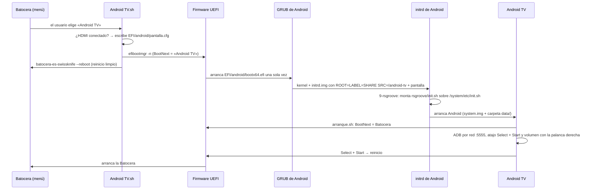

# Cómo funciona

## El camino completo

## Las piezas

| Pieza | Dónde vive | Qué hace |
| --- | --- | --- |
| `es_systems_android.cfg` | `/userdata/system/configs/emulationstation/` | Suma el sistema «Android TV» al menú. Lo lee el menú y sobrevive a las actualizaciones. |
| `Android TV.sh` + `gamelist.xml` | `/userdata/roms/android/` | El lanzador: arma `BootNext` y reinicia limpio. Desde la v1.4.0 deja `pantalla.cfg` vacío: Android arranca siempre en la notebook y `pantalla.sh` lo pasa a la tele. |
| Entrada UEFI «Android TV» | NVRAM del equipo | Apunta a `\EFI\android\bootx64.efi`. **No está en `BootOrder`**: solo se usa con `BootNext`. |
| `bootx64.efi`, `boot/grub/`, `.disk/<marca>.uuid` | Partición FAT32 aparte | El GRUB de la ISO encuentra su configuración por la marca. |
| `grub.cfg` | Partición FAT32, `boot/grub/` | Menú de arranque: automático, solo tele, solo notebook, sin asistente, video seguro, volver a la Batocera. |
| `pantalla.cfg` | Partición FAT32, `EFI/android/` | Lo escribe el lanzador antes de reiniciar. |
| `kernel`, `initrd.img`, `system.img`, `ramdisk-recovery.img` | `/userdata/android-tv/` | Android. `system.img` es el sistema modificable (ext4). |
| `data/` | `/userdata/android-tv/data/` | El `/data` de Android: apps, cuentas y ajustes. |
| `fstab.android` | `/userdata/android-tv/` | Qué monta el initrd y desde dónde. |
| `scripts/9-rsgroove` | `/userdata/android-tv/scripts/` | El initrd carga `scripts/*` con `source`; este define `post_detect()` y monta nuestro `init.sh`. |
| `rsgroove/init.sh` | `/userdata/android-tv/rsgroove/` | El `init.sh` de Android + 2 líneas que lanzan `arranque.sh`. Lo genera `herramientas/generar-init.sh`. |
| `arranque.sh` | `/userdata/android-tv/data/rsgroove/` (= `/data/rsgroove/`) | Corre como root en cada arranque: `BootNext`, ADB por red, atajo Select + Start y volumen con la palanca derecha (`ABS_RZ` → `input keyevent VOLUME_UP/DOWN`). |
| `pantalla.sh` | `/data/rsgroove/` | Pantalla automática: con la tele conectada pasa Android a la tele y el sonido al HDMI; sin tele, vuelve a la notebook. |
| `cerrar.sh` + app `ar.rsgroove.cerrartodo` | `/data/rsgroove/` y el inicio | «Cerrar todo»: cierra todas las apps abiertas (también la ventanita flotante) y vuelve al inicio. |
| `ajustes.conf` | `/data/rsgroove/` | Ajustes que la revisión de arranque repone en cada arranque (idioma, animaciones, video por la placa, procesador, memoria). |
| `Vendor_2563_Product_0523.kl` | `/data/system/devices/keylayout/` | Botones como en la Batocera para el joystick ShanWan. |

## La pantalla: notebook o tele (v1.4.0)

- Android arranca **siempre en la pantalla de la notebook**, sin órdenes `video=` al cargador. Con
  `video=eDP-1:d video=HDMI-A-1:…` (o apagando la notebook antes de prender la imagen) la tele quedaba **azul y rayada**.
- `pantalla.sh` mira cada 2 s `/sys/class/drm/card*-HDMI-A-1/status`. Si la tele está conectada 6 s seguidos:
  1. sonido por la tele (ver abajo); 2. `echo off > card*-eDP-1/status` y `setprop ctl.restart vendor.hwcomposer-2-4`
  (la imagen se va a negro unos 30 s y vuelve en la tele); 3. comprueba otra vez el sonido.
  Si la tele se desconecta 10 s, hace lo mismo al revés. Freno: 4 cambios en 5 minutos.
- Registro: `/data/rsgroove/pantalla.log`.

## Sonido por la tele

El controlador de sonido principal (`audio.primary.x86`) **ignora las salidas HDMI** («ignore pcmC0D3p») salvo con
`hal.audio.primary.hdmi=1`. Sin esa opción Android queda sin ninguna salida y las apps dicen «tu formato de video no es
compatible». `pantalla.sh` pone `hal.audio.primary.hdmi=1` y `hal.audio.out` / `hal.audio.out.speaker` = `pcmC0D3p`
(HDMI 0), y reinicia en orden el controlador (`vendor.audio-hal`), espera, y después `audioserver`.

## Cerrar todo

Una app común no puede cerrar otras. La app «Cerrar todo» solo se abre; `cerrar.sh` (root) la ve en el registro de
eventos (`wm_on_resume_called`) y hace `am force-stop` a las apps de todas las tareas abiertas, salvo el inicio y el
sistema, y vuelve al inicio. Lo mismo con **Select + Círculo**. Registro: `/data/rsgroove/cerrar.log`.

## Por qué sobrevive a las actualizaciones de la Batocera

- Todo está en `/userdata`, en una partición FAT32 aparte y en una entrada UEFI propia. Nada en la partición
  `BATOCERA`, que es la que la actualización reescribe.
- Ningún script de la Batocera usa `efibootmgr`: las actualizaciones no tocan entradas UEFI ajenas.
- La Batocera sigue primera en `BootOrder`: si algo de Android falla, el equipo arranca la Batocera.

## Por qué un reinicio limpio

Un apagado de golpe dañó una vez `batocera.conf`. El lanzador usa `batocera-es-swissknife --reboot`, que cierra el
menú y los servicios en orden. Se lanza desacoplado (`setsid … &`) porque mata al «emulador» que lo llamó.
