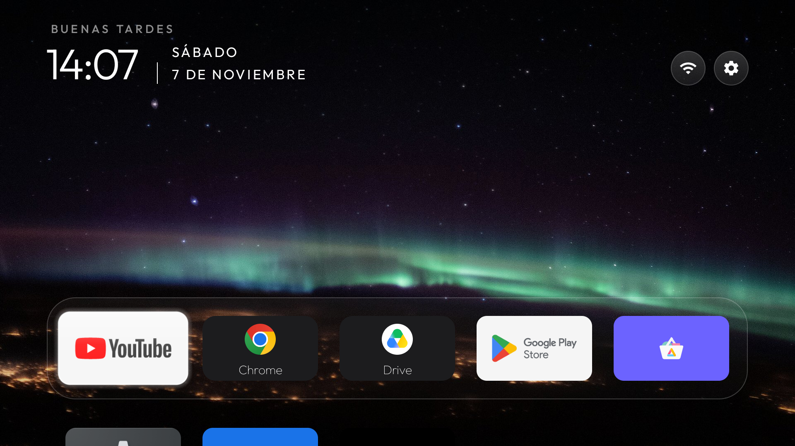

# El inicio «RS Groove» (CleanYourTV + tema propio)



El inicio es el de [CleanYourTV](https://github.com/Gathin23/cleanyourtv) (Gathin, licencia MIT): estilo Apple TV, con
saludo, reloj, fecha, botones de Wi-Fi y Ajustes, y una barra de apps de vidrio. Encima va el tema **RS Groove** de
este repositorio (`tema/rs-groove/`): **18 imágenes que cambian cada minuto**, en orden aleatorio (anime en neón,
paisajes de anime y la Tierra vista desde el espacio).

De CleanYourTV se usa **solo el inicio**. Su otra parte, «limpiar» la tele (`tools/disable.sh`, apaga apps de fábrica),
**no se usa**: este Android ya viene limpio y podría apagar piezas que necesitan microG y la Play Store.

Probado con CleanYourTV `d451b17` (07/11/2026), inicio versión 3.4.

## 1. Armar el inicio en la PC (Windows)

CleanYourTV no publica el inicio armado: se compila. Hace falta Java 17 a 22 y el SDK de Android (plataforma 34 y
build-tools 34). Gradle 8.9 lo baja solo el proyecto.

**Ojo con la carpeta:** si el nombre de usuario de Windows tiene `&` (por ejemplo `C:\Users\Ana & Juan`), los `.bat` de
estas herramientas se rompen. Usá una carpeta sin símbolos, como `C:\rsgtv`.

1. Java 21 (Temurin, de Eclipse Adoptium), en zip:
   <https://adoptium.net/temurin/releases/?version=21> → `C:\rsgtv\jdk`. Comprobá su sha256 con el publicado.
2. Herramientas de línea de comandos de Android: <https://developer.android.com/studio#command-line-tools-only> →
   descomprimir en `C:\rsgtv\sdk\cmdline-tools\latest\`. Comprobá su sha256 con el de esa página.
3. Licencias y paquetes (desde Git Bash):

   ```bash
   export JAVA_HOME='C:\rsgtv\jdk'
   cd /c/rsgtv/sdk/cmdline-tools/latest/bin
   yes | ./sdkmanager.bat --sdk_root='C:\rsgtv\sdk' --licenses
   ./sdkmanager.bat --sdk_root='C:\rsgtv\sdk' "platforms;android-34" "build-tools;34.0.0"
   ```

4. Bajar CleanYourTV y armar el inicio:

   ```bash
   cd /c/rsgtv && git clone https://github.com/Gathin23/cleanyourtv.git && cd cleanyourtv && git checkout d451b17
   printf 'sdk.dir=C:/rsgtv/sdk\n' > launcher/local.properties
   ```

   ```powershell
   $env:JAVA_HOME = 'C:\rsgtv\jdk'; $env:GRADLE_USER_HOME = 'C:\rsgtv\gradle'
   cmd /c "cd /d C:\rsgtv\cleanyourtv\launcher && C:\rsgtv\cleanyourtv\launcher\gradlew.bat assembleRelease"
   ```

   Sale `launcher\app\build\outputs\apk\release\app-release.apk` (unos 590 KB). Conviene comprobar antes que
   `gradle/wrapper/gradle-wrapper.jar` sea el oficial: su sha256 tiene que ser igual a
   <https://services.gradle.org/distributions/gradle-8.9-wrapper.jar.sha256>.

No usamos `launcher\build-and-install.ps1`: apaga el inicio que está en uso y frena si no lo conoce (por ejemplo TV
Detox). Instalamos a mano, sin apagar nada.

## 2. Instalarlo en Android

```bash
adb install -r app-release.apk
adb shell pm grant com.gathin.tvhome android.permission.ACCESS_FINE_LOCATION   # para mostrar el nombre del Wi-Fi
```

## 3. Pasarle el tema RS Groove

El inicio lee el tema de su carpeta (`/sdcard/Android/data/com.gathin.tvhome/files/`). Los archivos se escriben por su
proveedor (`content://com.gathin.tvhome.theme`), así quedan a nombre del inicio. Desde Git Bash, en la carpeta de este
repositorio:

```bash
export MSYS_NO_PATHCONV=1
URI=content://com.gathin.tvhome.theme; DIR=/sdcard/Android/data/com.gathin.tvhome/files; TMP=/data/local/tmp/cyt
poner() { adb push "$1" "$TMP-x" && adb shell "rm -f $DIR/$2; content write --uri $URI/$2 < $TMP-x && rm -f $TMP-x"; }
adb shell "am start -n com.gathin.tvhome/.MainActivity"        # la primera vez, para que exista su carpeta
poner tema/rs-groove/config.json config.json
for f in tema/rs-groove/wallpapers/*.jpg; do poner "$f" "wallpapers/$(basename "$f")"; done
python -c "import uuid;print(uuid.uuid4().hex,end='')" > theme_revision && poner theme_revision theme_revision
```

`theme_revision` es una marca nueva en cada envío: le avisa al inicio que hay un tema nuevo.

## 4. Dejarlo como inicio

```bash
adb shell cmd package set-home-activity --user 0 com.gathin.tvhome/.MainActivity
adb shell 'am force-stop com.gathin.tvhome; input keyevent HOME'
```

El inicio anterior (TV Detox o el de LineageOS) queda instalado. Para volver a TV Detox:
`adb shell cmd package set-home-activity --user 0 com.ansub.tvhome/.MainActivity`.

## Qué hace el tema (`config.json`)

| Clave | Valor | Para qué |
| --- | --- | --- |
| `wallpaper_rotation_minutes` / `wallpaper_order` | `1` / `shuffle` | Una imagen nueva cada minuto (lo más rápido que permite), sin repetir seguidas |
| `dock_apps` | YouTube, Chrome, Drive, Play Store, Aurora | La barra principal, en ese orden |
| `library_apps` | Chrome, Drive | **Apps de celular en el inicio.** El inicio muestra solo apps de TV; las de celular aparecen si están acá o si se suman desde la Biblioteca |
| `app_library` | `true` | Botón «Biblioteca de aplicaciones»: suma o saca apps del inicio desde la tele |
| `hidden_apps` | KernelSU, el mapeador de teclas, TV Detox | Fuera del inicio (siguen en la Biblioteca) |
| `columns` | `5` | Apps por fila |

El resto viene del tema `weeb` de CleanYourTV: fondo negro, barra de vidrio, botones redondos, saludo. Todas las claves:
`themes/README.md` de CleanYourTV.

## Imágenes propias

Se pueden sumar fotos o imágenes propias a `tema/rs-groove/wallpapers/` (JPG, nombres con letras, números, `.`, `_` y
`-`) y volver a pasar el tema. CleanYourTV trae `tools/wallpaper_prep.py`, que las recorta a 16:9, las achica y las
oscurece un poco para que se lea el reloj. Los cambios de imagen son de golpe (sin fundido) y como mínimo cada minuto.
